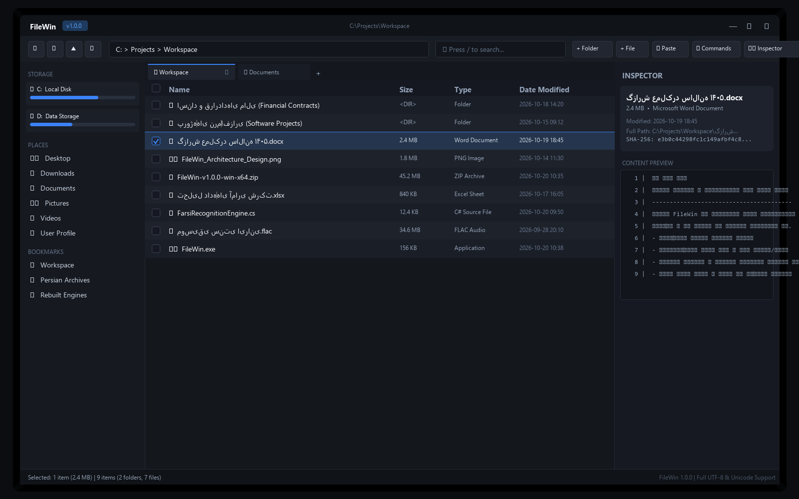

<div align="center">

# 🚀 FileWin (Unicode & UTF-8 Edition)

**A high-performance, modern dual-pane file manager for Windows built with full UTF-8 & Persian (Farsi) character recognition, in-line tree expansion, live file watching, and a sleek dark UI.**

[](LICENSE)
[](https://dotnet.microsoft.com/)
[](https://microsoft.com)
[](https://github.com/torrex-v/FileWin/releases/tag/v1.0.0)
[](#-full-utf-8--unicode-recognition)

<br/>



</div>

---

## 🌟 Highlights & Key Capabilities

### 🌐 Full UTF-8 & Unicode Recognition
Unlike traditional Windows file managers that choke or display missing glyph boxes on non-Latin filenames, **FileWin** is engineered from the ground up for seamless, first-class UTF-8 and Unicode character recognition across all files, paths, and document contents:
* **Persian (Farsi) & Arabic Script Support**: Native support for all Persian-specific letters (**گ**, **چ**, **پ**, **ژ**, **ک**, **ی**, **ۀ**, **ھ**) alongside the full Arabic Unicode block.
* **Bidirectional (BiDi) & Contextual Shaping**: Seamless right-to-left (RTL) text rendering with correct cursive letter shaping (initial, medial, final, isolated forms).
* **Persian Alphabetical Collation**: Custom natural sorter adhering strictly to the Persian alphabetical order:
  $$\text{آ} \rightarrow \text{ا} \rightarrow \text{ب} \rightarrow \text{پ} \rightarrow \text{ت} \rightarrow \dots \rightarrow \text{ک} \rightarrow \text{گ} \rightarrow \dots \rightarrow \text{ی}$$
* **Unified Keyboard & Diacritic Normalization**: Real-time search engine automatically normalizes Arabic Kaf (`ك`) to Persian Ke (`ک`), Arabic Yeh (`ي`) to Persian Ye (`ی`), handles Persian digits (`۰`–`۹`), and strips zero-width non-joiners (ZWNJ / نیم‌فاصله) and diacritics/harakat during queries.

---

### ⚡ Feature Set

* **Dual-Pane & Multi-Tabbed Navigation**: Open multiple tabs, split views horizontally or vertically, and navigate with seamless session persistence.
* **Quick Access Sidebar**:
  * **Storage**: Live drive cards showing capacity, free space, and animated disk usage meters.
  * **Places**: Instant access to Desktop, Downloads, Documents, Pictures, Videos, and User Profile.
  * **Bookmarks**: Quick pinning and removal of favorite directories.
  * **Recents**: Automatically maintained navigation history.
* **In-Line Tree Folder Expansion (`Ctrl+E`)**: Expand and collapse folder trees directly inside the file list view with hierarchical indentation.
* **Interactive Checkboxes**: Multi-selection via row checkboxes and a header checkbox to Select/Deselect All.
* **Sleek Dark Theme**: Clean palette (`#14171c` background, `#181c23` panels, and dark navy `#25354d` row selection with `#3b82f6` electric blue borders).
* **100% Asynchronous Performance**:
  * Non-blocking directory loading with background threads.
  * Asynchronous folder size and item count calculator.
  * Debounced live `FileSystemWatcher` reflecting file additions, deletions, renames, and modifications without UI stutter.
* **Inspector & File Preview**:
  * Live SHA-256 hash generation for files.
  * Direct image previews (PNG, JPG, BMP, GIF, WEBP, ICO).
  * Syntax and line-numbered text file viewer with automatic RTL detection.
* **Command Palette (`Ctrl+P` / `F1`)**: Search through all commands with fuzzy matching and instant execution.

---

## ⌨️ Keyboard Shortcuts

| Shortcut | Action |
| :--- | :--- |
| `/` | **Quick Search**: Focus and select all in the search filter |
| `Ctrl + E` | **Tree Expand**: Toggle in-line folder expansion |
| `Ctrl + P` / `F1` | **Command Palette**: Open floating command palette |
| `Ctrl + T` | **New Tab**: Open a new browsing tab |
| `Ctrl + W` | **Close Tab**: Close active tab |
| `Ctrl + Shift + N` | **New Folder**: Create a new folder |
| `Ctrl + N` | **New File**: Create a new empty text document |
| `F2` | **Rename**: In-place rename selected item |
| `Del` | **Delete**: Move selected item to Recycle Bin |
| `Shift + Del` | **Permanent Delete**: Permanently delete selected item |
| `Ctrl + C` / `X` / `V` | **Clipboard**: Copy, Cut, and Paste files |
| `Ctrl + I` | **Inspector**: Toggle right inspector sidebar |
| `Alt + Left` / `Right` | **Navigation**: Go back / Go forward |
| `Alt + Up` / `Backspace` | **Navigation**: Go up to parent folder |
| `Alt + E` | **Explorer**: Open current folder in Windows Explorer |
| `Ctrl + \`` | **Terminal**: Open current directory in Terminal / PowerShell |
| `F5` | **Refresh**: Reload directory contents |
| `Esc` | **Dismiss**: Clear search or close command palette |

---

## 📦 Installation & Download

Pre-built standalone 64-bit Windows executables are available in the [Releases](https://github.com/torrex-v/FileWin/releases) section:

1. Download **`FileWin-v1.0.0-win-x64.zip`**.
2. Extract the archive to any folder.
3. Run **`FileWin.exe`** (no installer required).

---

## 🛠️ Building from Source

### Prerequisites
* Windows 10 or 11 (x64)
* [.NET 9.0 SDK](https://dotnet.microsoft.com/download/dotnet/9.0) or later

### Build Instructions

```bash
# Clone the repository
git clone https://github.com/torrex-v/FileWin.git
cd FileWin

# Restore and build the solution
dotnet build FileWin.sln

# Run all unit tests
dotnet test tests/FileWin.Tests/FileWin.Tests.csproj

# Publish standalone release binary
dotnet publish src/FileWin/FileWin.csproj -c Release -r win-x64 --self-contained false -o publish
```

---

## 📄 License

This project is licensed under the [MIT License](LICENSE).
